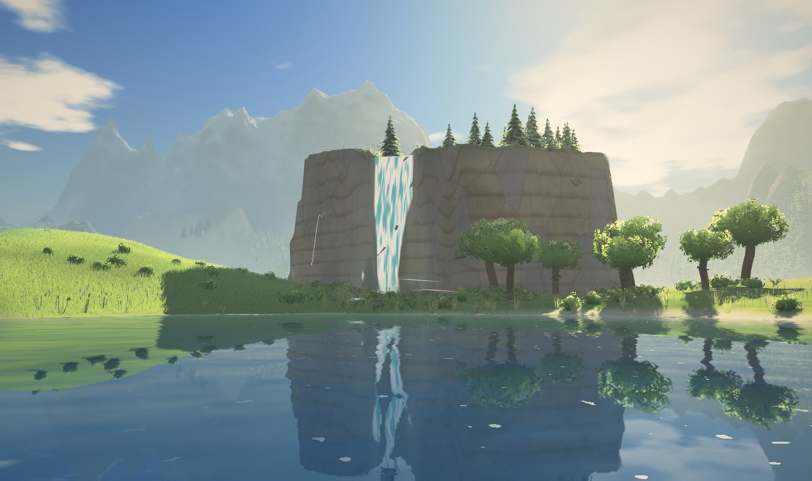
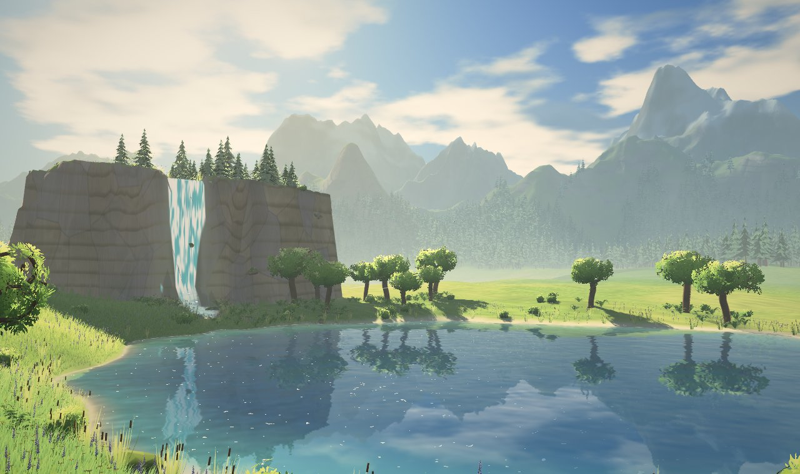
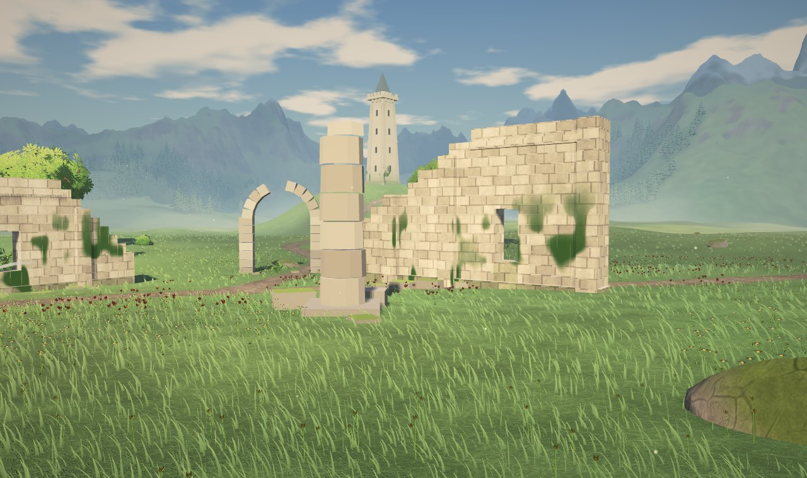
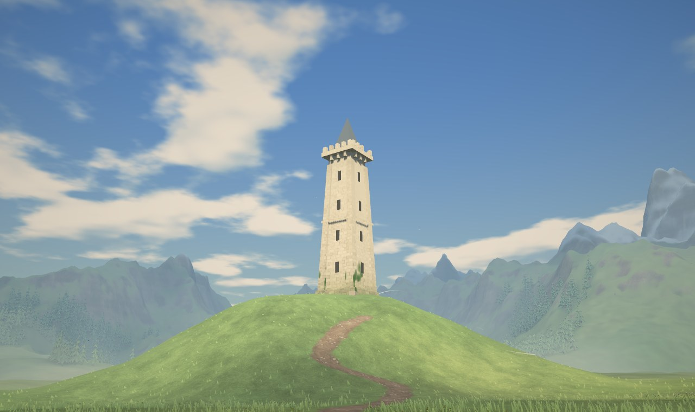
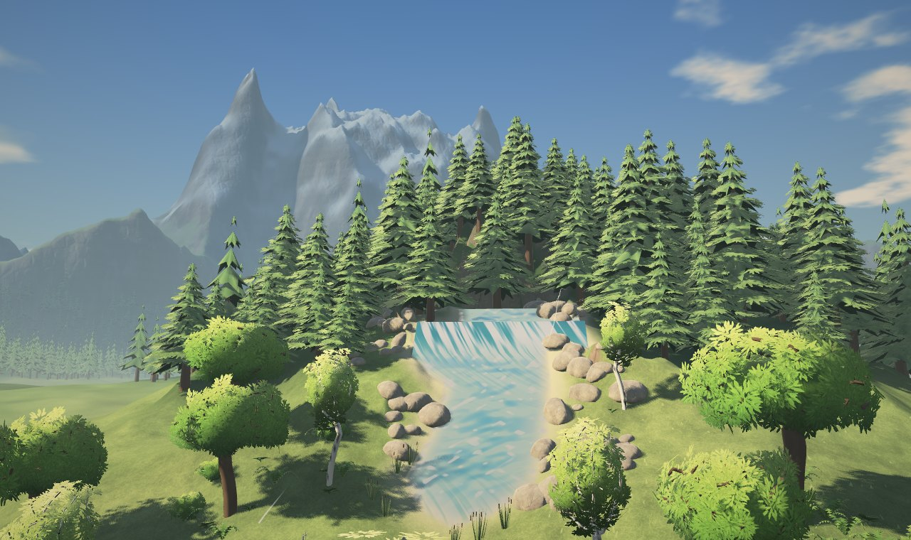
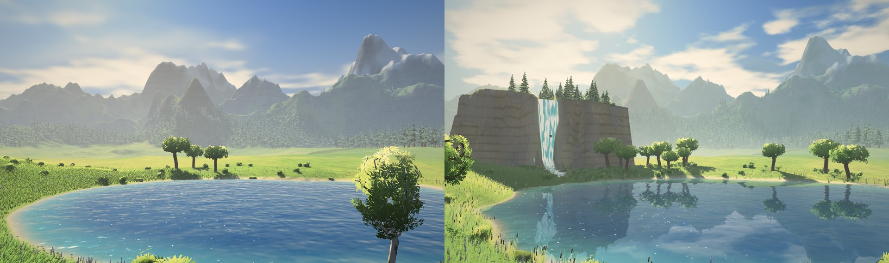

# land · 面向 agent 的地图编辑器

**目标：让 agent 只靠写代码，就能做出《塞尔达传说：旷野之息》水准和质感的开放世界美术场景。**

传统地图编辑器是给人用的：拖笔刷、摆物件、在视口里反复调整。agent 没有手和眼睛，它擅长的是写代码、读结构化反馈、按截图迭代。所以 land 把整张地图做成了一段 `scene.js`：地形、侵蚀、湖和河、树花石、草地、环境与镜头，全部是函数调用。每次调用立即执行并返回结果，构建完成后输出带行号的结构化报告，配合无头出图，agent 可以形成「写脚本 → 看报告和截图 → 改脚本」的闭环。

附带的示例场景「镜湖原野」是一片湖畔山谷：西侧台地上的瀑布泻入湖中、倒映在湖面上，东北小山流下一条溪；一条土路从南边草甸经过遗迹，通向湖岸和东南山丘上的瞭望塔；四周是分层的远山和针叶林。



| 湖岸 | 遗迹 |
| --- | --- |
|  |  |
| **瞭望塔** | **溪流** |
|  |  |

同一机位的前后对比（左：初版，右：当前）：



## 设计原则

**面向 agent**

- **场景即代码**：没有隐藏状态，`scene.js` 就是地图的全部定义，可以 diff、review、版本管理。
- **立即执行、有返回值**：`m.water.lake()` 直接返回水位和面积，`m.heightAt()` 随地形修改实时更新，后面的代码可以基于前面的结果做决策。
- **可解释的反馈**：每次调用都记录耗时、状态和 `scene.js` 行号；散布被规则拒绝时按原因计数（例如 `放置 7/45 · 拒绝：slope 940, height 837`），agent 知道该放宽哪条规则。
- **确定性**：所有生成器都由种子驱动，同一份脚本永远得到同一张地图。测试会锁定示例场景的生成结果。
- **无头可用**：世界生成不依赖浏览器，可以直接在 Node 里跑；渲染通过 Playwright 出图。

**旷野之息的美术标准**

- **生态驱动的布局**：植被由坡度、湿度（汇流累积）、坡向日照、离水距离决定，而不是随机撒点。
- **大气纵深**：雾色随环境和时刻变化（绿地偏青绿、黄昏偏暖），远山压成剪影；低处有成片的山谷雾，太阳有大片眩光。
- **风是主角**：草浪亮带、成簇摆动的树、风痕和飞絮由同一个风场驱动。
- **绘画感的光**：柔和的明暗交界、逆光透射、边缘光、冷暖分区调色，而不是写实 PBR。
- **可读的剪影**：树冠、岩石、山脊、崖壁、塔楼都有清晰的轮廓和层次。
- **关卡设计**：地标让人定位，遗迹是沿路的兴趣点，土路引导视线；台地和瀑布构成画面焦点。

## 快速开始

```bash
npm install
npm run dev      # 打开 http://localhost:8000 ，在主界面选地图；修改场景脚本后刷新即可
npm run build    # 生成 dist/index.html：所有地图打进一个单文件，离线可用，可以直接双击打开
```

- 打开页面先进入主界面，列出 [`maps.js`](maps.js) 里的地图（镜湖原野、哈特诺式山村和四个对照场景），点卡片现场生成。底部栏的「地图」按钮（或按 M）随时回到主界面，Esc 返回当前地图。地址里的 `?map=<id>`（例如 `?map=hateno`）直接进入某张地图，刷新后还在同一张。
- 加一张地图：写一份调用 `defineScene` 的场景脚本，在 `maps.js` 里登记 `id`、文件、标题、简介和预览镜头，再用 `node tools/thumbs.mjs <id>` 渲染预览图。
- 拖动旋转视角，滚轮缩放，鼠标划过草地会拨开草叶。
- 底部栏切换镜头，调节时刻和风力。
- 右上角「构建报告」里有每次调用的执行记录、调试视图（坡度、等高、侵蚀、离水距离、汇流），以及完整的脚本 API 参考。

## 第一人称漫游

点底部栏的「第一人称」或按 `V`，就能以玩家视角走进地图：

| 操作 | 键位 |
| --- | --- |
| 移动 | `WASD` / 方向键，鼠标转视角（点击画面锁定鼠标，`Esc` 释放） |
| 冲刺 | 按住 `Shift` |
| 跳跃 | `空格`（约 1.2 m，可以跳上矮坎） |
| 飞行 | `F` 或双击 `空格` 切换；飞行时 `空格` 上升、`C` 下降，`Shift` 疾飞；飞到地面自动落地 |
| 退出 | `V`，或点任意镜头 |

走路会被陡坡（约 49° 以上）挡住，树、石头、遗迹和塔都有碰撞；走进深水会浮起来游泳。从高空镜头进入时直接处于飞行状态。手机上是左下摇杆加跳、飞、冲刺、下降按钮，拖动画面转视角。

agent 也可以用脚本走一遍再截图，例如：

```js
mapEditor.walk({ x: -56, z: 70, yaw: 0 });     // 站到南边草甸上，面朝北
mapEditor.input({ forward: 1, sprint: true });  // 按住 W + Shift
mapEditor.step(3);                              // 推进 3 秒（固定步长，结果可复现）
mapEditor.player();                             // { x, y, z, speed, grounded, flying, swimming, … }
mapEditor.snapshot();
```

## 场景脚本

```js
defineScene((m) => {
  const t = m.terrain;
  t.mountains({ inner: 420, outer: 760, height: 100 });
  t.erode({ grid: 'far', droplets: 110000 });
  t.hill(15, -80, { radius: 62, height: -15, shape: 'smooth', warp: 16 });  // 挖湖盆，轮廓不再是正圆
  t.plateau(-78, -122, { radius: 30, height: 26, cliff: 5 }); // 四周是垂直崖壁的台地

  m.path([[-62, 140], [-40, 38], [-26, -10], [-44, -58]], { width: 2.6 });   // 土路：草和树会避开
  const creek = m.water.river([[122, -128], [84, -104], [40, -86]], { width: 6 });
  m.water.river([[-86, -116], [-61, -104], [-40, -94], [-22, -86]], { width: 4 }); // 从台地边缘落下，就是瀑布
  const lake = m.water.lake(15, -80, { fill: 'spill' });     // 自动取溢出水位，返回 { level, area }
  m.log(`湖面 ${lake.level}m`);

  // 沿溪流两岸种白桦：调用立即生效，可以马上查询离水距离
  creek.points(11).forEach(([x, z, , tx, tz], i) => {
    const s = i % 2 ? 1 : -1, px = x - tz * s * 10, pz = z + tx * s * 10;
    if (m.waterAt(px, pz).dist > 3) m.place('tree.birch', px, pz);
  });

  m.scatter('tree.oak', {
    count: 22, area: m.circle(0, -10, 135),
    rules: { slope: [0, 0.28], moisture: [0.18, 1] },         // 湿润平缓的低地
    cluster: { size: 4, radius: 18 },                          // 成簇分布
  });
  m.place('tower', 95, 62);                                    // 地标
  m.scatter('fern', { count: 320, area: m.circle(0, -10, 150), rules: { canopy: [0.2, 1] } });  // 林下
  m.grass({ center: [0, -10], radius: 172 });                    // 草由 GPU 在镜头周围分级生成，铺满整个谷地也不增加开销
  m.env({ time: 0.28, haze: '#86b3a3', valleyFog: { height: -4, thickness: 12, density: 0.0035 } });
  m.camera('falls', { at: [44, -84], eye: 1.6, look: [-46, -102], lookEye: 9 });
});
```

| 分类 | 调用 |
| --- | --- |
| 地形 | `t.noise` `t.mountains` `t.peak` `t.hill` / `t.raise` / `t.lower` `t.flatten` `t.plateau` `t.terrace` `t.smooth` `t.erode` `t.thermal` `t.apply((x, z, h) => …)` |
| 水 | `m.water.river(path, …)` → `{ length, drop, points() }`（陡段自动画成瀑布），`m.water.lake(x, z, …)` → `{ level, area }` |
| 路 | `m.path(points, { width, flatten, wear })` → `{ length }` |
| 物件 | `m.scatter(kind, { count, area, rules, cluster })`，`m.place(kind, x, z, { rotation, scale })` |
| 村庄与建筑 | `m.village({ center, radius, houses, style, … })` → 房屋 / 道路 / 田地的位置，`m.building(x, z, { style, front, floors, tower, … })`，`m.fence(path, { style })`，`m.field({ center, size, crop })` |
| 草与环境 | `m.grass(…)` `m.env({ time, wind, haze, hazeFar, valleyFog, clouds, glare, snowLine, rock, … })` `m.camera(name, …)` |
| 查询 | `m.heightAt` `m.slopeAt` `m.normalAt` `m.waterAt` `m.flowAt` `m.moistureAt` `m.sunAt` `m.noise` `m.random(seed)` |

散布规则 `rules` 支持 `height`、`slope`、`waterDist`、`moisture`、`sun`、`canopy`（树荫，均为 `[min, max]`）和 `noise` 遮罩；水下和路面上不会放置。

模型库：

- 树木：`tree.oak` `tree.big` `tree.birch` `tree.pine` `bush`
- 林下与水边：`fern` `plant.broadleaf` `reed`
- 花：`flower.daisy` `flower.poppy` `flower.lupine` `flower.buttercup`
- 岩石：`rock.boulder` `rock.cliff` `rock.pebble`
- 遗迹与地标：`ruin.wall` `ruin.pillar` `ruin.arch` `tower`
- 村庄：`house`（`house.hateno` `house.stone` `house.timber` `house.hut`）`fence.wood` `fence.stone` `well` `lantern` `stall` `windmill` `signpost` `barrel` `crate` `haybale` `woodpile` `cart` `crop.wheat` `crop.cabbage`

所有模型都有 LOD：每种模型登记几个切换距离，近处是带全部细节的版本（窗框、百叶窗、花箱、椽头、乱石、叶片卡片），远处逐级换成更省的版本，花草和小杂物超出距离直接剔除；切换带 6% 的回差，镜头在边界附近移动不会来回跳。

## 村庄编辑器

一行 `m.village()` 生成一个完整的村子，返回值里有每栋房屋（门口和门前街道上的点 `street`）、道路和田地的坐标，可以接着加工、取镜头：

```js
const v = m.village({ center: [0, -8], radius: 62, houses: 18, style: 'mixed', fields: 3, lanterns: 15, seed: 4 });
m.building(40, 12, { style: 'hateno', front: 'gable', floors: 2, tower: true, banner: true });   // 单独盖一栋
m.fence([[30, 0], [44, 0], [44, 14]], { style: 'stone' });
m.field({ center: [70, 20], size: [20, 12], rotation: 0.3, crop: 'wheat', fence: 'wood' });
m.camera('house', { at: v.houses[0].street, eye: 1.7, look: [v.houses[0].x, v.houses[0].z], lookEye: 3 });
```

- **房屋**按参数生成（`src/objects/buildings.js`），造型和材质对着旷野之息 / 王国之泪哈特诺村的截图做：赭黄 / 米色灰泥墙，墙脚的灰泥按不规则的边沿剥落、露出底下的乱石（边沿顺着石块起伏，偶尔高处也掉一块），墙角是圆润的倒角，一部分房子墙角砌着长短相间、倒了棱的条石；门窗是在墙上真正开的洞，窗子小而深，带灰泥窗洞侧壁、伸出墙外的木窗台、折贴在墙上的木板百叶窗（绿、蓝灰、褐），窗下花箱里是一丛丛叶子和五瓣小花；门板退进门洞，钉着铁折页，门前是倒棱的石阶；壁灯是铁框玻璃灯笼挂在铁臂下；陶土瓦屋顶一排排瓦是真实的台阶状几何（每排下沿翘起一片瓦厚），压在深色木结构上（封檐板、山墙博风板、露出的椽头和檩条头、半圆脊瓦）；贴着山墙的高烟囱下宽上窄、像拉长的截头方锥（撑着木杆、顶上一顶小瓦帽）；屋后角上的圆塔和圆锥瓦顶、门上的小雨棚、临街的布幡、门口的陶罐。风格还有乱石墙配条石墙角的石屋、白墙木构架屋和茅草小屋；`front: 'gable'` 让山墙朝街。没给的参数按 seed 随机，所有随机选择都会固定下来，规划和模型完全一致。
- **布局**：主街和一两条支路穿过广场（水井、集市摊、路灯），房屋沿路排开、门朝街，退距和朝向各有出入，沿街留出空地；每家门口一条踩出来的小路通到街上；坡地上的宅基地削坡成台，下坡一侧露出高高的乱石台基，门前砌石阶；后院围篱笆种菜，墙边种花和灌木，门口堆木桶木箱柴堆；空地种大树，村外开田（地面翻出垄沟）、高处立风车、村口立路牌。避开水面、陡坡、道路和彼此，全部由 seed 决定。
- **氛围**：`m.env({ time })` 拨过 1.0 以后窗户、壁灯和路灯亮起来（点光源照亮周围的墙和地面），烟囱冒炊烟，天上出星星；`m.env({ rock })` 给崖壁和石头换主色（灰白石灰岩、红砂岩……）；`t.flatten({ mode: 'cut' })` 只削不填，可以在坡上开出平台。
- 示例场景 [`scenes/village.js`](scenes/village.js)：缓坡上的哈特诺式山村，背后是石灰岩台地，下午的暖光。对照截图登记在 `refs/sources.json`（`hateno`、`hateno-street`、`hateno-house`），`node tools/compare.mjs hateno-house` 直接并排比较。

参数的权威定义在 [`src/runtime/schema.js`](src/runtime/schema.js)，页面里的「脚本 API」面板由它生成。

## 给 agent 的出图循环

```bash
# 构建场景，按镜头出图并打印报告（不需要先 build，直接用源码）
node tools/render.mjs hero lake river

# 自定义镜头、查询、调试视图
node tools/render.mjs '{"name":"close","at":[-12,-22],"eye":2,"look":[-5,-30],"lookEye":4}' \
  --eval "mapEditor.heightAt(15, -80)" --view 5

# 换一份场景脚本、打开主界面上的某张地图，或者渲染打包后的单文件
node tools/render.mjs --scene my-scene.js --out out/my-scene
node tools/render.mjs --map hateno
node tools/render.mjs --page dist/index.html --map jinghu

# 重新渲染主界面的地图预览图（docs/maps/*.jpg）
node tools/thumbs.mjs [id ...]
```

`--scene` 让页面跳过主界面直接构建这份脚本（`?scene`）；`--map` 和主界面一样按 `maps.js` 打开地图（`?map=id`）。`node tools/build.mjs --scene file` 打出只含一份场景、没有主界面的单文件。

输出目录（默认 `out/`）里有每个镜头的 PNG 和 `report.json`。构建出错时进程以非零状态退出。

### 对照参考截图

```bash
node tools/fetch-refs.mjs        # 把 refs/sources.json 里的参考截图下载到 refs/（图片不进仓库）
node tools/compare.mjs faron     # 渲染 scenes/ref/faron.js 的 ref 镜头，和参考图并排，输出 out/compare/faron.png
node tools/compare.mjs my.jpg --scene scene.js --camera hero    # 任意参考图 + 任意场景镜头
```

`compare.mjs` 按参考图的宽高比出图，并打印一张指标表：暗部 / 中间调 / 高光、反差、饱和度、冷暖、天空和植被的颜色与亮度、1–5px 与 5–20px 两个频段的细节量，标出差距最大的几项。`scenes/ref/` 里有四个按旷野之息截图构图的对照场景（法罗尼草原、起伏草丘、遗迹日落、法罗尼岩壁），引擎的调色、光照和材质都是对着它们逐项调的，改动落在共享代码里，所有场景一起受益。

页面加载后，`window.mapEditor` 提供 `run(fn)` 重建、`report()`、各种查询、`camera()`、`view()`、`walk()` / `input()` / `player()`（第一人称）、`pause()` / `step()` / `snapshot()` 等接口，供控制台或无头浏览器使用；`mapEditor.debug` 暴露 three.js 的 renderer、scene、camera 和共享 uniform，方便排查渲染问题；`mapEditor.debug.textures()` 返回烘焙出的材质贴图（PNG data URL）。

## 开发

| 命令 | 作用 |
| --- | --- |
| `npm run dev` | 本地静态服务，直接加载 `src/` 下的 ES 模块 |
| `npm run build` | 用 esbuild 打包成 `dist/index.html`（three.js、样式、所有地图的场景脚本和预览图全部内联） |
| `npm test` | Node 内置测试：核心算法、参数校验，以及示例场景的端到端生成 |
| `npm run lint` | ESLint |
| `npm run check` | lint + test + build，CI 跑的就是这一套 |
| `npm run render` | 无头出图，见上一节 |

three.js 版本由 `package.json` 锁定，开发和打包都从 `node_modules` 取，不依赖 CDN。

## 架构

```
maps.js             主界面上的地图列表（id、场景脚本、标题、简介、预览图）
scene.js            示例场景「镜湖原野」
scenes/village.js   示例场景「哈特诺式山村」
index.html          页面骨架（开发入口）
src/
  core/             纯算法：随机数、噪声、堆
  world/            高度网格、派生标量场（水、汇流、湿度、遮蔽）、构建版本号
  terrain/          地形操作：塑形、水力 / 热力侵蚀
  water/            河道开挖、湖泊泛洪、水体场
  objects/          模型库（树、花、石、房屋与村庄杂物）、村庄布局、散布与放置、草叶分布
  runtime/          脚本 API、参数 schema、世界生成流程
  render/           three.js 材质与着色器、贴图烘焙（texgen.js）、阴影、地平线图、后期、风痕、时刻
  app/              编辑器编排、镜头、第一人称（walker.js 物理 + first-person.js 输入）、界面、window.mapEditor
  styles/           页面样式
tools/
  build.mjs         打包单文件
  render.mjs        无头构建 / 出图 / 查询
  compare.mjs       和参考截图并排对比，输出指标表
  fetch-refs.mjs    下载参考截图
  thumbs.mjs        渲染主界面的地图预览图
refs/               参考截图来源与对照配置（sources.json）
scenes/ref/         按参考截图构图的对照场景
test/               node --test
docs/               截图、地图预览图（docs/maps/）与架构说明
```

依赖只能自上而下：`core → world → terrain / water / objects → runtime → render → app`。`runtime` 及以下不碰 DOM 和 WebGL，所以整套世界生成可以在 Node 里运行和测试。模块划分、构建流程和扩展方式（新增脚本操作、新增模型）见 [docs/architecture.md](docs/architecture.md)。

## 用到的算法

**地形**
- **侵蚀 fBm**：叠加噪声时累加梯度，坡越陡，后续细节越被压平，直接得到主脊加分支沟谷的山体（Quilez）。
- **水滴式水力侵蚀**：同时输出磨损图，供着色使用。
- **热力侵蚀**：超过安息角的物质向下滑落。
- **河道生成**：沿 Catmull-Rom 路径挖出单调下降的河床。
- **湖泊填充**：优先队列泛洪求溢出水位。

**水文与生态**
- **多流向汇流累积**（MFD，Freeman 1991）：得到湿度场，驱动沟谷着色、积雪和植被分布。
- **坡向日照**：用于区分向阳坡和背阴坡。
- **成簇散布**：Thomas 点过程。

**模型**
- **阔叶树**（`objects/crown.js`）：对比了 L 系统、参数化递归（Weber & Penn 1995、ez-tree）、空间殖民（Runions et al. 2007）、自组织树（Palubicki et al. 2009）和纹理叶团（Livny et al. 2011）后，按风格化树的需要组合成：
  - **叶团树冠**：树冠是 8–22 个相互重叠约一半的圆形叶团，不是一个大球，轮廓有起伏、叶团之间有缝；叶团不往树冠下半部放，主枝露在树冠下面。
  - **骨架**：树干和第一次分叉显式铺设（叶团按方向用 k-means 分成 3–5 组，每组一根向外再上扬、略带侧弯的主枝），其余用空间殖民分两遍长：第一遍只以叶团中心为吸引点，每个叶团长进一根枝；第二遍在叶团内撒点，长出从叶缝里露出来的细枝。枝干粗细按管道模型 r^n = Σ r_i^n 推出，分叉处子枝从父枝里加粗长出，没有台阶。
  - **叶片**：卡片撒在每个叶团的表层，朝向随机（朝外会在叶团边缘侧对镜头，轮廓变光滑）；法线 60% 取自所在叶团的球面、40% 取自整个树冠的椭球（风格化树的法线投射做法），每个叶团像一团柔软的体积那样受光，背光侧的叶团整体偏暗；颜色向叶团和树冠的内侧、下侧加深，每个叶团内部有一个暗色填充团，不会显得透光。贴图是一簇小枝，每枝互生卵形叶，叶片沿主脉分出受光面和背光面。
  - **LOD**：近处是细枝 + 密的小卡片；中距离只留主枝、换成更少更大的卡片；远处每个叶团换成一个带叶簇的块状球，法线同样朝树冠外侧混合。管子按 LOD 限制边数并拉开环距。
- 松树是层叠针叶加叶簇卡片；针叶裙的底面用圆锥的外向法线（被上一层挡住阴影时仍有天光，不会发黑）。
- 岩石是带两层起伏的细分球体，被几个随机半空间柔和地切出圆润的平面和棱，平滑法线；表面铺岩石贴图和法线贴图，苔藓按顶面朝向渐变长出。
- 遗迹墙是 4.5–7.5m 的连续石墙，顶部按砌层逐级坍落，带勒脚、壁柱、檐口和拱窗，爬山虎从墙脚往上长，周围散落碎石；砌缝由着色器绘制，石块内部有石材纹理；瞭望塔是连续的收分塔身加扶壁、腰线和挑台，砌缝由着色器按像素尺寸过滤绘制，远看不会出现锯齿条纹。
- 蕨是拱形叶轴加成对小叶，芦苇是外倾叶片加香蒲穗；伞形白花（`flower.umbel`）是圆顶状的一簇簇白色小花。
- 房屋由参数拼装：墙面按门窗的矩形切开（水平带 × 洞之间的区段），洞口补上灰泥侧壁；墙面按高度分段着色（墙根、檐下的遮蔽），墙角用一条法线转过拐角的窄带做出圆角；屋顶瓦层按贴图的瓦排逐排建成台阶，烟囱和圆塔是回转体（烟囱截面是圆角方形的超椭圆，法线按超椭圆求，侧面是平的而不是圆柱的明暗），山墙朝街的房屋整体转 90°。坡地上的房屋记下台基深度、抬升量和门前落差，模型据此加深勒脚、砌出台阶。

**渲染**
- **阴影**：太阳正交阴影贴图（叶片按 alpha 测试投影），4×4 个纹素中心按双线性权重做 3 纹素的盒式过滤，掠射角落在墙上的阴影边缘是平滑的，没有阶梯；阴影窗口中心在光源空间对齐到整纹素，摇摆的叶片按静止位置查阴影，走动时树冠不再闪烁。
- **深度与抗锯齿**：场景目标挂 24 位深度纹理（three.js 默认给渲染目标 16 位深度，远处树冠会 z-fighting 闪烁）；叶片卡片用 alpha-to-coverage，边缘随 MSAA 平滑。
- **地平线图**：8 个方位，用于天空可见度和随时刻变化的山体大尺度投影。
- **材质贴图**：启动时在 GPU 上一次性绘制可平铺的材质贴图（`render/texgen.js`）：岩石（扭曲 Voronoi 岩板、各自倾斜并倒角，细裂隙时隐时现，表面颗粒）、草地地面（重叠的短笔触）、土路（半埋的石块、土块裂纹、砂粒），以及建筑用的陶土瓦（逐排错开、每片比瓦位略窄、下沿微弯微斜，瓦唇受光、上部压在上一排的阴影里，鲑红到赭红、偶有过火发暗、晒褪色或长地衣的）、灰泥（只画几厘米尺度的抹刀痕和砂粒；几米尺度的色调、墙脚的污渍和剥落由着色器按世界坐标加，不会每 2m 重复一次）、乱石（多边形切掉棱角的圆石，石面中间亮、向石缝变暗，低处长苔，嵌在退进去的深色灰浆里）、条石（凿面、斑驳、偶有凹坑，不画砌缝，每块石头是单独的几何）、木板、木瓦和茅草。图集里的贴图在像素覆盖超出可用的过滤范围时渐变到该材质的平均色（取格子中心的小 mip），屋顶侧看不再出现噪点。建筑材质合在一张带绕回边的图集里，物件着色器只占两个纹理单元（多数 GPU 每个着色器最多 16 个，超了整个材质不画）；建筑表面按米展开 uv，法线贴图用屏幕空间导数构造的切线框架（不需要存切线）。每种贴图由反照率 + 高度一次画成，再从高度推出法线贴图和凹陷遮蔽，带 mipmap。着色器按贴图采样，不再逐像素算噪声：近看有雕琢的细节，远处走 mipmap 平滑过滤，不闪烁。
- **崖壁**：岩石贴图按三向投影（triplanar）在 8m 和 38m 两个尺度采样，法线贴图用 whiteout 混合，凹陷处压暗；按区域着暖粉灰、冷灰和赭色，平台上长地衣；陡坡顶点沿下坡方向做三维噪声位移，崖面不再是平滑拉伸的一片。物件、草和第一人称都踩在位移后的岩面上（`terrain/crag.js` 的 `groundAt`），不会悬在崖壁外。
- **大气**：高度雾 + 只看距离的空气透视；山谷雾层沿视线积分指数高度雾，并用噪声切成飘动的雾团；雾色可按环境着色。
- **水**：湖面平面反射（镜像相机 + 斜近裁剪面，半分辨率，看不到湖时跳过）；河道陡段是白水急流。河水从坎沿跌落时离开河床：瀑布是沿抛物线离开坎沿的双层半透明水帘（越往下条纹越拉长、越白），落点有向外翻涌的泡沫圈和成团上涌、顺风飘散的水雾。
- **后期**：泛光、太阳眩光（按太阳处天空可见度缩放）、高光压缩加冷暖分区调色、屏幕空间体积光。
- **夜晚**：时刻拨过黄昏进入蓝调时刻和夜晚（月光色主光、暗蓝天空、星星，云沉成比天空略暗的剪影）；窗户和灯罩是自发光的，离镜头最近的 12 盏灯作为点光源参与所有材质的光照；烟囱的炊烟是随风飘散、逐渐变大变淡的烟团。
- **草**：GPU 草。构建时把草的密度、高度、地面高度和遮蔽烘成一张贴图；每帧在镜头周围按 5 级世界锚定网格生成草叶，每片草叶有一个等级值，距离越远保留越少（屏幕上密度不变），留下的草叶按比例加宽并变成矮簇，淡出时缩进地里而不是突然消失。远处没有草叶的地方，地面用同一套草色和成簇噪声着色，草地一直延续到地平线。带风浪亮带，鼠标划过时草叶被拨开。

## 对照旷野之息

画面是对着旷野之息实际截图调的：`scenes/ref/` 里四个按截图构图的场景，用 `tools/compare.mjs` 并排出图、逐项比指标。法罗尼草原这一张的变化（参考值 → 第一次对照 → 当前）：

| 指标 | 旷野之息 | 第一次对照 | 当前 |
| --- | --- | --- | --- |
| 天空饱和度 | 0.30 | 0.43 | 0.28 |
| 植被饱和度 | 0.33 | 0.43 | 0.36 |
| 暗部亮度 p5 | 0.29 | 0.45 | 0.21 |
| 1–5px 细节 | 2.24 | 1.70 | 2.72 |
| 5–20px 中尺度 | 3.63 | 2.50 | 3.52 |

对照中改掉的共性问题：草太高（近 1.3m，原作的草甸约 0.3–0.5m）；天空太蓝太饱和；远山被雾刷成白色，原作是保留起伏的蓝色；光照的卡通明暗交界把缓坡全部打满光，丘陵没有明暗；黄昏时草被染成褐色，原作保持绿色并逆光透亮；松树错用了阔叶贴图；遗迹是乐高式的矮石块；岩壁是木纹似的等高线。

还没追上的：遗迹日落那张的近景内容密度（5–20px 细节 2.9 vs 4.1）和逆光下的草地亮度；岩壁比原作偏暗偏冷；草的色相整体比原作偏绿约 8–10°。

## 距离目标还差什么

- **画面**：没有屏幕空间 AO；原作那种笔触感的后期滤镜、卡通描边还没做；没有天气（雨、雪、阴天）。和哈特诺村截图比，阴影还偏深（暗部 p5 0.07 vs 0.30），原作的空气更朦胧。
- **地貌**：地形是高度场，做不出内凹、洞穴和天然石拱；只有温带草原一种生物群落。
- **内容**：没有动物、村民和声音；建筑只有民居一类，还没有桥、马厩、营地、拱门和挡土墙；村里的树还偏「棒棒糖」形。
- **规模**：可行走的细节区域是 ±160m（网格 0.8m），远景 ±1100m（网格 3.7m），还不是无缝大世界。
- **性能**：草叶由 GPU 在镜头周围生成（桌面 5 级 × 192² 实例，按视锥逐块剔除，覆盖约 245m），加上 9000 多棵松树、阴影、湖面反射和后期，只在软件渲染下测过，真机帧率未测；手机上会自动降低草的级数和范围、阴影和反射分辨率。
- **agent 工作流**：还没有场景之间的 diff、局部重建，以及对截图的自动美术评估。
