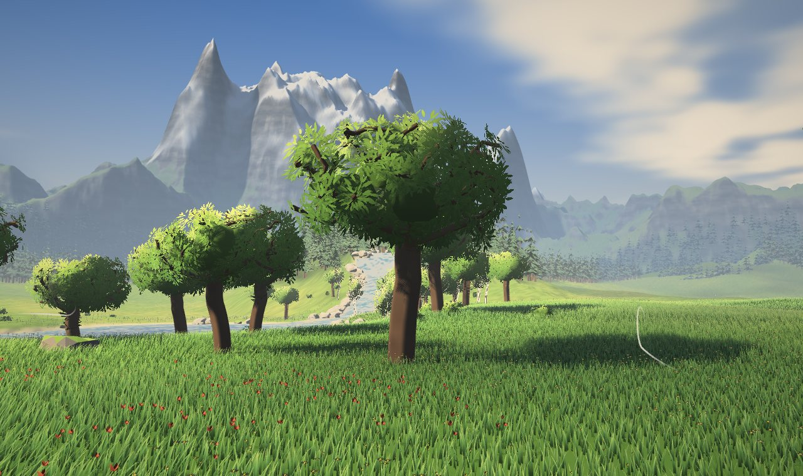
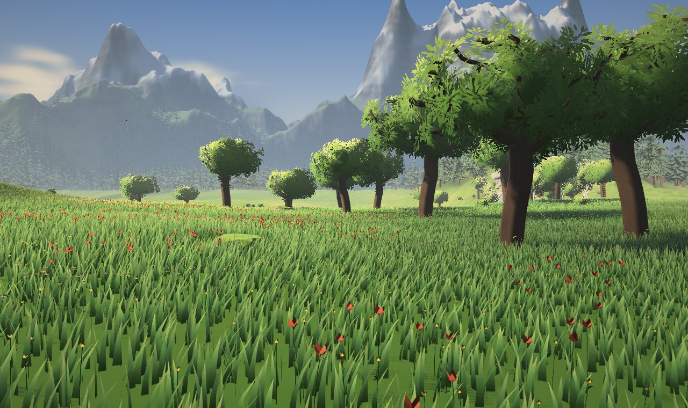

# land · 原野场景引擎

面向 agent 的 three.js 场景引擎。场景不是在编辑器里手工摆出来的，而是一段 `scene.js` 代码：地形、侵蚀、湖和河、树花石、草地、镜头，都由函数调用生成。每次调用立即执行并有返回值，构建结束后输出结构化报告，agent 可以根据报告和截图迭代场景。

附带的示例场景是「镜湖原野」：一片湖畔山谷，东北小山流下一条溪注入湖中，四周是分层的远山和针叶林，画风参考《塞尔达传说：旷野之息》。


| 湖岸 | 原野树丛 |
| --- | --- |
|  |  |
| **溪流** | **花田** |
|  |  |

## 快速开始

直接用浏览器打开 `index.html`。three.js 从 jsDelivr 加载，所以需要联网。

- 拖动旋转视角，滚轮缩放。
- 底部栏可以切换镜头，调节时刻和风力。
- 右上角"构建报告"里有每次调用的执行记录（带 scene.js 行号）、调试视图（坡度、等高、侵蚀、离水距离、汇流），以及完整的脚本 API 参考。

## 场景脚本

场景写在 `scene.js` 里：

```js
defineScene((m) => {
  const t = m.terrain;
  t.mountains({ inner: 420, outer: 760, height: 100 });
  t.erode({ grid: 'far', droplets: 110000 });
  t.lower(15, -80, 62, 15);                                   // 挖湖盆

  const creek = m.water.river([[122, -128], [84, -104], [40, -86]], { width: 6 });
  const lake = m.water.lake(15, -80, { fill: 'spill' });     // 自动取溢出水位，返回 { level, area }
  m.log(`湖面 ${lake.level}m`);

  // 沿溪流两岸种白桦：调用立即生效，可以马上查询离水距离
  creek.points(11).forEach(([x, z, , tx, tz], i) => {
    const s = i % 2 ? 1 : -1, px = x - tz * s * 10, pz = z + tx * s * 10;
    if (m.waterAt(px, pz).dist > 3) m.place('tree.birch', px, pz);
  });

  m.scatter('tree.oak', {
    count: 22, area: m.circle(0, -10, 135),
    rules: { slope: [0, 0.28], moisture: [0.18, 1] },         // 湿润平缓的低地
    cluster: { size: 4, radius: 18 },                          // 成簇分布
  });
  m.grass({ center: [0, -15], radius: 118 });
  m.camera('hero', { at: [-84, -28], eye: 3.4, look: [25, -140], lookEye: 10 });
});
```

主要接口：

| 分类 | 调用 |
| --- | --- |
| 地形 | `t.noise` `t.mountains` `t.peak` `t.hill` / `t.raise` / `t.lower` `t.flatten` `t.smooth` `t.erode` `t.thermal` `t.apply((x, z, h) => …)` |
| 水 | `m.water.river(path, …)` → `{ length, drop, points() }`，`m.water.lake(x, z, …)` → `{ level, area }` |
| 物件 | `m.scatter(kind, { count, area, rules, cluster })`，`m.place(kind, x, z)` |
| 草与环境 | `m.grass(…)` `m.env({ time, wind, fogDensity, snowLine })` `m.camera(name, …)` |
| 查询 | `m.heightAt` `m.slopeAt` `m.normalAt` `m.waterAt` `m.flowAt` `m.moistureAt` `m.sunAt` `m.noise` `m.random(seed)` |

散布规则 `rules` 支持 `height`、`slope`、`waterDist`、`moisture`、`sun`（均为 `[min, max]`）和 `noise` 遮罩。被拒绝的候选点会按原因计数写进报告，例如 `放置 7/45 · 拒绝：slope 940, height 837`，据此就知道该放宽哪条规则。

模型库：`tree.oak` `tree.big` `tree.birch` `tree.pine` `bush` `flower.daisy` `flower.poppy` `flower.lupine` `flower.buttercup` `rock.boulder` `rock.cliff` `rock.pebble`。

页面加载后，`window.mapEditor` 提供 `run(fn)` 重建、`report()`、各种查询、`camera()`、`view()`、`pause()` / `step()` / `snapshot()` 等接口，供控制台或无头浏览器使用。

## 给 agent 的出图循环

```bash
npm install                      # 只装一份本地 three@0.147.0，供离线渲染使用
pip install playwright && python3 -m playwright install chromium

# 构建场景，按镜头出图，打印报告
python3 tools/agent_render.py engine.html scene.js out hero lake river

# 自定义镜头和查询
python3 tools/agent_render.py engine.html scene.js out \
  '{"name":"close","at":[-12,-22],"eye":2,"look":[-5,-30],"lookEye":4}' \
  --eval "mapEditor.heightAt(15, -80)" --view 5

# 把 scene.js 内联进引擎，生成可直接打开的 index.html
python3 tools/agent_render.py engine.html scene.js --bundle index.html
```

输出目录里有每个镜头的 PNG 和 `report.json`。

## 用到的算法

**地形**
- **侵蚀 fBm**：叠加噪声时累加梯度，坡越陡，后续细节越被压平，直接得到主脊加分支沟谷的山体（Quilez）。
- **水滴式水力侵蚀**：同时输出磨损图，供着色使用。
- **热力侵蚀**：超过安息角的物质向下滑落。
- **河道生成**：沿 Catmull-Rom 路径挖出单调下降的河床。
- **湖泊填充**：优先队列泛洪求溢出水位。

**水文与生态**
- **多流向汇流累积**（MFD，Freeman 1991）：得到湿度场，驱动沟谷着色、积雪和植被分布。
- **坡向日照**：用于区分向阳坡和背阴坡。
- **成簇散布**：Thomas 点过程。

**模型**
- **空间殖民算法**生长树枝（Runions et al. 2007），枝干粗细由管道模型推出。
- 树冠用叶片卡片，法线从外包球传递。
- 松树是层叠针叶加叶簇卡片。
- 岩石用随机半空间切割球体，再叠加岩层，得到平面块状。

**渲染**
- **阴影**：太阳正交阴影贴图（叶片按 alpha 测试投影）。
- **地平线图**：8 个方位，用于天空可见度和随时刻变化的山体大尺度投影。
- **雾**：随高度变薄的高度雾，距离越远越偏蓝。
- **后期**：泛光、高光压缩加冷暖分区调色、屏幕空间体积光。
- **草**：实例化草叶，带风浪亮带，鼠标划过时草叶被拨开。

## 目录

```
index.html          打包好的成品（engine.html + scene.js）
engine.html         引擎模板，/*SCENE*/ 处插入场景脚本
scene.js            示例场景「镜湖原野」
tools/agent_render.py  无头构建 / 出图 / 查询 / 打包
docs/               截图
```

## 已知限制

- 30 万草叶、9000 多棵松树，再加上阴影和后期，只在软件渲染下测过，真机帧率还没测。手机上会自动降低草的密度和阴影分辨率。
- 可行走的细节区域是 ±160m，网格精度 0.8m；远景区域是 ±1100m，网格精度 3.7m。
- 没有屏幕空间 AO，原作那种笔触感的后期滤镜也还没做。
